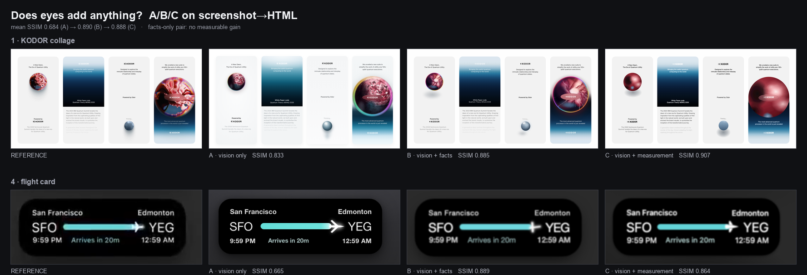
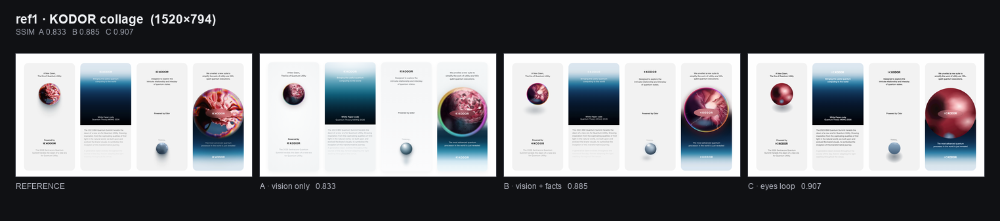
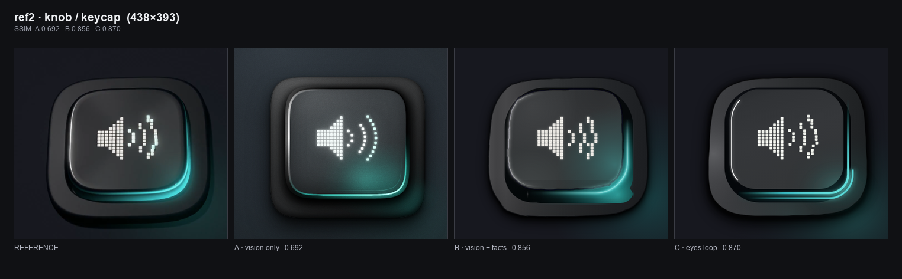
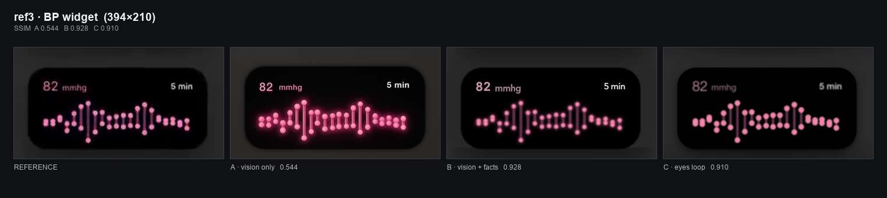
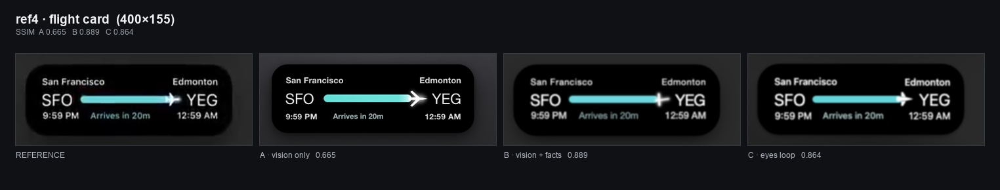
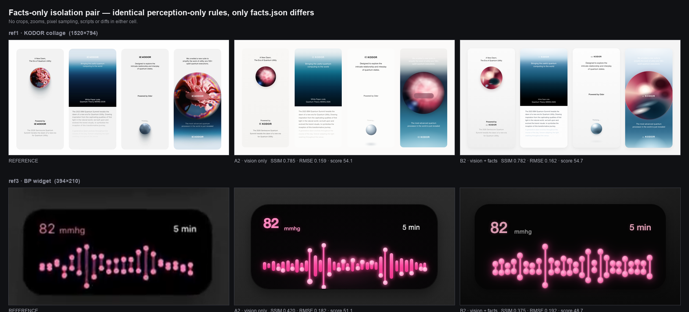

# Does `eyes` add anything? A controlled reproduction test

**Question.** For a multimodal agent that can already see, does the `eyes`
instrument improve screenshot→HTML/CSS reproduction, or is it redundant?

**Short answer (details below).** As a *perception substitute* it is largely
redundant and sometimes harmful: in the clean facts-only pair the sheet changes
nothing (ref1 0.785 vs 0.782 SSIM; ref3 0.420 vs 0.375), and it injects errors.
As a *measurement instrument* it is genuinely additive: vision-only averages
**0.684 SSIM**, a measurement loop averages **0.888** — a +0.20 jump, and the
same jump the agents got from building their own rigs (B 0.890, C 0.888). The
useful artifact for this task is `parse`/`score`/`pixdiff`, not `interrogate`'s
fact sheet.



## Design

Four references from `deepseek_package/images/`, three sensing modes, isolated
directories, identical renderer (`render.sh`, headless Chrome at exact reference
size), identical iteration budget (3-5 render→look→fix cycles), same model for
every cell (`deepseek-account/deepseek-flash`).

| arm | extra input | live tools |
|---|---|---|
| **A** | none — vision only | none |
| **B** | `facts.json` = precomputed `eyes interrogate` sheet | none (facts-in-context) |
| **C** | none | `eyes score`, `pixdiff`, `zoom` in the loop |

Arms are blind to each other: each cell is its own directory; Arm A never sees a
fact sheet, Arm B never runs a tool, Arm C never reads the sheet.

After the first run exposed a protocol confound (B agents built their own
measurement rigs — see "Protocol adherence"), two clean isolation cells were
added: **A2 vs B2**, identical perception-only rules, on ref1 and ref3, with the
fact sheet as the only difference. One slot was free and the failure was
systematic, so re-running all four was not necessary to establish the direction.

Judging: `eyes pixdiff` SSIM (pixel truth, independent of the semantic scorer),
changed-pixel fraction, full-resolution RMSE, and `eyes score` normalized
against each reference's *self-score ceiling*. The self ceiling matters: an
identical image does **not** score 100 (see "Scorer calibration" below), so raw
scores are not comparable across references.

## The four references, and what each arm produced

Caveat: 3 of 4 references are photographic/3D product renders, so pixel fidelity
is capped by "can CSS fake a render" rather than by perception. `ref1` carries
most of the signal; `ref3`/`ref4` are tractable widgets; `ref2` mainly tests
glow/shape approximation.

### ref1 · KODOR collage (1520×794) — real UI, the most reproducible



Both A and B get the four cards, copy and layout; B pulls ahead on the orbs and
spacing. C wins on pure geometry. B renders the sheet's `MOwQ` OCR error; A and C
get `M0WQ` right.

### ref2 · knob / keycap (438×393) — 3D product render



A reads it as a rounded square. B traces the plate silhouette and neon from
sampled edges; C traces the silhouette and fits the tube arc. Both B and C are
recognisably the same object; A is a sketch of it.

### ref3 · BP widget (394×210) — dark UI



The biggest gap: A misses the card geometry and the bead rhythm (0.544). B
measures 21 columns at 13.2px pitch (0.928); C closes the loop to 0.910.

### ref4 · flight card (400×155) — dark UI



A's plane is an arrow. B measures every row's ink box (0.889); C's loop (0.864)
is close but its semantic score fell while its pixels improved — see the
calibration section.

## What the fact sheet actually says — and whether it is true

`interrogate` emits six question groups: background, glow, text inventory,
layout family, alignment, selection/accent blobs. Claim-by-claim audit against
the images:

### ref1-collage — the weak case

- **palette** `#f4f4f4 (42%)` — **true** (card background is ~`#f5f5f5`).
- **glow** "bright region near cell (0,0) mean_rgb=[253,253,253]" — **true but
  useless**: it found the white page.
- **layout family** "unstructured (10 rows × 4 cols)" — **true**, there are four
  columns. But `unstructured` undersells it: it is a 4-up card grid.
- **text inventory, 16 strings** — the weak part. Real text has ~14 blocks plus
  6 logo marks. Complete strings captured: ~5. Partial first-lines-only: ~6.
  Missing entirely: the hero line **"A New Dawn,"**, **"White Paper code"**, the
  entire faded paragraph, and every second/third line of the body blocks
  ("simplify the work of utility-era 100+ qubit quantum executions.", "Summit
  heralds the dawn of a new era for Quantum Utility.", etc.). Garbled:
  `M0WQ`→`MOwQ`, "advanced quantum"→"advenced quentum", `Thinking...`→`Thinking..`.
- **alignment** — **actively misleading.** Rows are grouped by y only, so a row
  concatenates text from *different cards*: `y=151 "KKODOR KKODOR We unveiled a
  new suite to"` → `"right"`. Three independent centered cards have been fused
  into one right-aligned line. This is the single most dangerous output for a
  reproducer, because it looks precise and is wrong.
  (Cause: `eyes/interrogate.py` `_row_items()` groups by y with no x-clustering,
  then classifies the union's bbox — `interrogate.py:135-157`.)
- **blobs** — 5 regions with plausible x/y anchors for the orbs/gradients;
  shapes ("ring-ish"/"disc-ish") are loose. Useful as coarse anchors, not specs.

### ref2-knob

- **palette** `#141c1c (18%)` — plausible for the dark teal-grey ground.
- **glow** "bright region near cell (11,5) mean_rgb=[164,162,158]" — **wrong
  target**: that is the grey/white specular rim, not the teal glow. The teal
  glow is the one thing you would want from this image.
- **text** 0 — **true**.
- **blob** `[186,157,186,157]` `rgb(49,144,145)` `fill .16` — **true and
  useful**: that is the teal rim light's position and hue. This blob is the
  sheet's best contribution on this reference.
- Missing: keycap geometry, radius, inner/outer shells, the pixel-grid speaker
  glyph, the black notch — i.e. everything that makes it a keycap.

### ref3-bp

- **palette** `#040404 (43%)` — **true**.
- **glow** "none detected" — **false negative**: there is a soft pink glow
  around the ECG dots.
- **text** `82`, `mmhg`, `5 min` — **3/3 correct**.
- **blobs** `[49,100,286,84]` `rgb(168,94,127)` and `[49,68,30,16]` — **true**:
  the ECG band and the "82". Good anchors.
- Missing: type sizes/weights, card radius, pink hue per-dot (the mean is
  diluted by background), the vertical connector lines.

### ref4-flight

- **palette** `#040404 (47%)` — **true**.
- **glow** "none detected" — **false negative**: the turquoise line glows.
- **text, 12 strings** — **fragment soup**: `San`, `San Francisco`, `9:59`,
  `9:59 PM`, `12:59`, `12:59 AM`, `Arrives`, `20m`. All substrings are real,
  but 7 real phrases have become 12 overlapping fragments. A reproducer that
  renders the inventory literally will duplicate text. Missing `in`.
- **blob** `[110,70,160,16]` `rgb(106,193,197)` — **true**: the turquoise
  progress line's position and color. Shape "disc-ish" is wrong (it is a bar),
  but the geometry is right.

### Pattern

Probe-by-probe, across the four references:

| probe | ref1 | ref2 | ref3 | ref4 | usable? |
|---|---|---|---|---|---|
| background/palette | correct | bin vs true color dispute | correct | value right, label wrong | 3/4 |
| glow | useless (white page) | wrong target (specular) | false negative | false negative | **0/4** |
| text inventory | missing hero line, garbled | n/a (no text) | correct | fragment soup | 2/4 |
| layout family | 4 columns correct | n/a | "1×7" undercounts 21 columns | "3×19" odd | 1/4 |
| alignment | wrong (fuses cards) | n/a | "wide", useless | "wide", useless | **0/4** |
| accent blobs | coarse anchors | teal rim correct | ECG + "82" correct | track correct | 3/4 |

Independently, the four B agents recorded **10 distinct fact-sheet conflicts**
in their VERDICTs (glow 3×, blob-is-not-a-selection 3×, palette 1×, structure
1×, text fragments 1×) and corrected them from vision. The sheet's consumers
spent part of their budget auditing the instrument.

Also: the reported hexes are **5-bit bin centers**, not sampled colors
(`eyes/color.py:34-55`). `#17181f` quantizes to `#141c1c`, `#f5f5f5` to
`#f4f4f4`; every channel can be off by ±4. That is fine for "roughly this
color", misleading if a reproducer uses the hex verbatim. B/ref2 caught exactly
this and rendered the true `#17181f`.

The sheet is **QA-shaped, not rebuild-shaped**. It answers "what is in this
image?" — palette, rough regions, OCR tokens — and says nothing about what a
reproducer actually needs: per-element bounding boxes, border radii, font
size/weight/line-height, gradient stops, shadow parameters, per-column grouping.
Worse, it stamps every field `"confidence": "measured"`, when the text inventory
and alignment are frequently partial or wrong. That violates the project's own
SCENE rule — *"if the instrument can't measure something, it says so, it doesn't
guess"*. A consumer that trusts the label will be misled exactly where its own
eyes were better.

For comparison, `eyes parse` already emits normalized element/text bboxes — much
closer to a rebuild spec than `interrogate`'s answers. It is the better artifact
for this task, and `interrogate` is the wrong one to ship in an A/B package.

## Scorer calibration (a real bug worth fixing)

Identical images do not score 100:

| reference | self-score | palette component |
|---|---|---|
| ref1-collage | 93.4 | 0.737 |
| ref2-knob | 89.6 | 0.584 |
| ref3-bp | 96.6 | 0.863 |
| ref4-flight | 96.9 | 0.874 |

Cause: `score_palette` (`eyes/score.py:206-212`) intersects the **top-8 palette
bins only**, and those bins cover less than all pixels, so the maximum reachable
component is the top-8 *coverage* (exactly the numbers above: 0.7373, 0.5844,
0.8630, 0.8741). Fix: normalize by `sum(ref_fracs)` in the denominator, or add
an explicit `other` bin. Without that, a fixed 3-15 point penalty is baked into
every score, and cross-reference comparisons are invalid.

The same component is also **brittle to tiny global color shifts**, because it
is an exact 5-bit-bin intersection with no color-distance tolerance. On
`ref2-knob` (self-score 89.6):

| perturbation | composite `score` | palette | SSIM | mismatch |
|---|---|---|---|---|
| none | 89.6 | 0.584 | 1.000 | 0.0% |
| brightness +2% | 82.1 | 0.545 | 0.9999 | 0.0% |
| brightness −2% | 53.3 | 0.342 | 0.9982 | 0.0% |
| Gaussian blur 1px | 73.6 | 0.578 | 0.9848 | 1.5% |

A 36-point composite swing for a change that is invisible in SSIM and to the
eye. Consequences: (a) `score` is not a fidelity metric, it is a color-exactness
metric with sharp cliffs; (b) **B has an artificial advantage** on `score`,
because the fact sheet hands it the exact palette hexes while A must estimate
them; (c) the repo's reproduction loop optimizes this scalar, so it is partly
optimizing bin luck. Use `ssim_mean`/`mismatch_frac` for truth, and treat
`score` as a semantic sanity check only. A perceptual palette distance
(nearest-bin within a ΔE tolerance, or soft histogram) would fix the cliff.

The composite can even move **opposite** to pixel truth on a fine edit. C/ref4's
recorded trajectory:

| iteration | composite score | SSIM | what happened |
|---|---|---|---|
| 1 | 86.0 | 0.801 | crisp first build |
| 2 | 78.1 | 0.810 | redrew the plane as a swept-wing SVG |
| 3 | 78.5 | **0.864** | slimmed plane, 1px softening, brighter text — best by every pixel measure |

The composite dropped 7.5 points while SSIM rose 0.063, because Mirage began
labelling the plane as an "arrow" and the card as a "smartphone screen". An agent
that optimized the composite would have kept the worse image. That is textbook
Goodhart: the semantic scorer is a useful *coarse* signal and a bad *fine*
objective. The agent noticed and reported it — but a loop that only sees `score`
would not.

## Protocol adherence — an important confound

The arms did **not** stay methodologically identical. Evidence in the cell
directories:

| cell | what the agent actually did |
|---|---|
| A/ref1 | crop/grid overlays of the reference (perception aid) |
| A/ref2 | no extra artifacts; vision only |
| A/ref3 | `measure.html` overlays, reports 21 measured bar positions |
| A/ref4 | no extra artifacts; vision only |
| B/ref1 | reports "pixel samples of the reference to calibrate geometry, text sizes and gradient stops" |
| B/ref2 | `gen.py` + `diff.png` (rendered diff) |
| B/ref3 | `gen.py`, `probe.json`, `diff.png`; reports pixel MAE; **7 render cycles** (budget was 5) |
| B/ref4 | `work/diff.png` |
| A2/B2 | clean pair: full-image perception only, no crops/sampling/scripts; B2 read `facts.json` |

So B is not "facts in context only". Given a sheet that presents itself as
measured, the B agents spontaneously built measurement rigs and closed the loop
by diffing their render against the reference. A did not (with the partial
exception of A/ref3, which measured the reference but did not diff its output).

**Consequence:** the A→B gain cannot be attributed to the fact sheet's
information content. It is confounded with "the agent started measuring". That
is itself a real effect — the sheet changes the process — but it is not the
effect the package claims to test. This is why a clean isolation pair
(`A2`/`B2`, ref1, identical perception-only rules, no crops/scripts/sampling,
fact sheet the only difference) was added.

## Proposed fixes (not applied)

1. **`score_palette`** (`eyes/score.py:206-212`): normalize by top-8 coverage so
   an identical image scores 1.0; optionally soft-assign each candidate bin to
   the nearest reference bin (RGB/ΔE tolerance) instead of exact-hex
   intersection. In a quick prototype, soft assignment gives 1.000 for identical,
   0.990 for 1px blur, 0.934 for +2% brightness (vs 0.863 / 0.578 / 0.545 today).
2. **`interrogate` alignment** (`eyes/interrogate.py:135-157`): cluster row items
   by x-gap (or use `structure` cells) before classifying alignment, and emit a
   bbox per cluster. Today a 4-column layout is fused into one right-aligned row.
3. **Text inventory**: dedupe nested fragments (`San` + `San Francisco`,
   `9:59` + `9:59 PM`), report coverage (lines found / lines detected), and stop
   labelling partial OCR `"measured"` — `"measured"` currently implies ground
   truth, which is exactly where the sheet misleads.
4. **Glow probe**: the "brightest grid cell" finds white specular highlights
   (ref2) and misses real colored glows (ref3, ref4 — both reported "none").
   Search for saturated chroma adjacent to bright cells instead.
5. **For reproduction specifically**: ship `parse`'s per-element bboxes (they are
   normalized and accurate to a few px) plus `layout`; leave `interrogate` for
   QA-style questions. An A/B package that claims to test "screenshot→HTML"
   should not hand the model QA answers.

## Harness note — macOS headless Chrome lies about its viewport

`RUNBOOK.md`'s render command is `chrome --headless --screenshot
--window-size=W,H`. On this machine (Chrome 157 / macOS) that captures a W×H
PNG but lays the page out in **max(500, W) × (H−87)** — the window frame and a
500px minimum window width leak into CSS. Measured: 400×155 → `innerWidth
500, innerHeight 68`; 394×210 → `500×123`; 1520×794 → `1520×707`.

Consequences: `vw`/`vh`, `width:100%`, and `right`/`bottom` resolve against the
wrong box; a `right:12px` element lands at x≈488 in a 400px capture, i.e.
off-canvas. One arm hit exactly this mid-run.

Fix: `tools/cdp_shot.js` (added) sets the layout viewport explicitly via
`Emulation.setDeviceMetricsOverride` and captures with CDP. Verified: all twelve
final A/B/C candidates re-render **pixel-identically** under it, so this quirk did
not corrupt the results — but it will bite anyone who uses the documented
command with viewport-relative CSS. `render.sh` in this experiment was left
unchanged so all cells stayed comparable.

## Results

### A vs B (as specified by the package)

Pixel metrics are the honest ones. `score` is shown against each reference's
self-ceiling.

| ref | arm | SSIM ↑ | mismatch ↓ | RMSE ↓ | score/ceiling | self-est |
|---|---|---|---|---|---|---|
| ref1-collage | A | 0.833 | 16.7% | 0.123 | 67.5/93.4 | 7 |
| ref1-collage | B | **0.885** | **9.2%** | **0.105** | 76.1/93.4 | 6 |
| ref2-knob | A | 0.692 | 26.5% | 0.124 | 50.8/89.6 | 5 |
| ref2-knob | B | **0.856** | **7.7%** | **0.073** | 63.8/89.6 | 6 |
| ref3-bp | A | 0.544 | 20.7% | 0.117 | 51.3/96.6 | 6 |
| ref3-bp | B | **0.928** | **4.7%** | **0.047** | 77.8/96.6 | 7 |
| ref4-flight | A | 0.665 | 12.9% | 0.160 | 76.4/96.9 | 7 |
| ref4-flight | B | **0.889** | **6.1%** | **0.060** | 89.1/96.9 | 8 |

B wins every pixel metric on every reference, and the margin grows with how
much the B agent measured:

- **ref1** (+0.05 SSIM): both agents got the four cards, copy and layout right.
  B reports pixel-sampling geometry/colors and its orbs are richer; A relied on
  crops. B reproduced the fact sheet's OCR error `M0WQ`→`MOwQ` (A got `M0WQ`
  right); B correctly took `A New Dawn,` from vision (the sheet omits it).
- **ref2** (+0.16 SSIM): A read the keycap as a rounded square; B traced the
  silhouette, bevel and neon from sampled edges, and lifted the 84 icon dots.
- **ref3** (+0.38 SSIM): B measured 21 dot columns at 13.2px pitch, per-bead
  colors and the card geometry, and ran 7 (not 5) cycles. A approximated.
- **ref4** (+0.22 SSIM): B measured every row's ink box (`SFO` at 45, `YEG`
  right edge 340, type sizes) and reports whole-image MAE 5.85/255.

But per the protocol section above, B's agents were measuring, not just reading
the sheet. The clean A2/B2 pairs isolate the sheet itself.

### Clean isolation pair — facts alone

Same model, same references, same renderer, same cycle brief, **perception-only
rules identical in both cells** (no crops, zooms, pixel sampling, scripts or
diffs). The only difference is `facts.json`. (B2/ref1 ran 8 cycles against a
3-5 brief, with no measurable benefit for it.)

| ref | arm | SSIM ↑ | mismatch ↓ | RMSE ↓ | score/ceiling |
|---|---|---|---|---|---|
| ref1-collage | A2 (no facts) | **0.785** | 22.6% | **0.159** | 54.1/93.4 |
| ref1-collage | B2 (facts) | 0.782 | **19.7%** | 0.162 | 54.7/93.4 |
| ref3-bp | A2 (no facts) | **0.420** | **22.9%** | **0.183** | 51.1/96.6 |
| ref3-bp | B2 (facts) | 0.375 | 26.6% | 0.192 | 48.7/96.6 |

**The fact sheet adds nothing measurable when the agent cannot measure.** ref1
is a dead heat; ref3 is slightly *worse* with facts. This is the cleanest
evidence for the central claim: the sheet's content (palette hexes, OCR tokens,
rough blob positions, alignment labels) is redundant with what a multimodal
agent can see, and it does not contain the geometry that the hard parts need
(bead pitch/height, card metrics, font metrics). The B2/ref3 agent even noted
that the sheet's structure claim under-counted the 21 waveform columns — the
sheet says "1 row × 7 cols".

Caveat: n=2 references, one run each. Directionally clear, not statistically
strong.



### Arm C — the measurement loop

| ref | A (vision) | B (facts + self-measure) | C (`eyes` loop) | winner |
|---|---|---|---|---|
| ref1-collage | 0.833 | 0.885 | **0.907** | C |
| ref2-knob | 0.692 | 0.856 | **0.870** | C |
| ref3-bp | 0.544 | **0.928** | 0.910 | B |
| ref4-flight | 0.665 | **0.889** | 0.864 | B |
| **mean SSIM** | **0.684** | **0.890** | **0.888** | tie |

Mean RMSE: A 0.131, B 0.071, C 0.067.

Two things stand out:

1. **C is ~0.20 SSIM above A on every reference** (+0.074, +0.178, +0.366,
   +0.199). The loop — measure, localize, re-measure — is the capability. It is
   not a small polish; it is the difference between "recognizable approximation"
   and "same widget".
2. **B and C are indistinguishable at this sample size** (0.890 vs 0.888, with B
   ahead on two references and C ahead on two). B reached that level by building
   its own measurement rigs; C reached it with `eyes`. *The source of the
   measurement barely matters; closing the loop does.*

C's traces also show the loop's real texture: positioning bugs found and fixed
(ref3 iter1→2), font metrics fitted against ink stats (ref3 iter4), gradients
rebuilt from sampled profiles (ref3 iter5), and — in ref1 and ref4 — composite
scores that *fell* while pixel fidelity rose (see calibration above). The
agents that succeeded used the score as a coarse signal and SSIM/pixdiff as
truth. The agents that trusted the composite would have shipped worse images.

### Self-calibration is weak

Every agent was asked for a 1-10 fidelity estimate. The estimates cluster in
5-8 and correlate only weakly with SSIM (Pearson 0.42 across the 12 cells that
had both): A/ref3 rated itself 6 at SSIM 0.544, B/ref1 rated 6 at 0.885, A/ref1
rated 7 at 0.833. The agents cannot reliably tell how close they are — which is
exactly the gap a deterministic score is supposed to fill. It also means the
self-estimate column is not evidence of anything except confidence.

## Interpretation

**Is `eyes` an addition to what a multimodal agent can already do?**

*As a fact sheet: no.* The clean isolation pair is the answer — with perception
held constant and only `facts.json` added, ref1 is a dead heat (0.785 vs 0.782)
and ref3 gets worse (0.420 vs 0.375). The sheet tells a seeing agent things it
can already see (three strings, a dark card, pink blobs), omits the things it
actually needs (per-bead pitch, card metrics, font metrics), and is wrong often
enough that its consumers spent part of their budget auditing it: 10+ recorded
conflicts, a 0/4 hit rate on the glow probe, a wrong alignment model for
multi-column layouts, and an OCR error (`M0WQ` → `MOwQ`) that propagated into
B/ref1's HTML while the vision-only A got it right. It is a compression of
vision, and a lossy one.

*As a measurement instrument: yes, decisively.* Vision-only averages 0.684 SSIM.
With a measurement loop — `eyes score`/`pixdiff`/`zoom` (C) or the agent's own
recording rigs (B) — the average is 0.889 (B 0.890, C 0.888). That +0.20 is the difference between
"recognizable approximation" and "same widget". The loop supplies the two things
perception does not: a calibration signal (the agents' own 1-10 estimates
correlate at only r≈0.42 with measured fidelity) and localization (where the
error is, in pixels, at what magnitude). It also explains why the package's A/B
looked so good for B: the fact sheet cued the agents to measure, and measuring
did the work. B and C tie with their different instruments.

This is not an argument against the project — it is the project's own thesis.
`PRD.md` says frontier models "fall back to algorithmic tools (crops, color
thresholding, intensity profiles, code execution) for precise quantitative
analysis". `SCENE.md`'s ideal user is a text-only agent that "can run commands
and read JSON". For that user the fact sheet *is* the eyes. For a multimodal
agent, the eyes are already there; what is still missing is the ruler.

**What I would ship next**

- For screenshot→HTML, feed `parse`'s per-element bboxes (normalized, accurate to
  a few px) and `layout`, not `interrogate`'s answers. A "rebuild spec" probe —
  element bboxes, radii, font size/weight, gradient stops, shadow params — is
  the missing artifact.
- Make the loop's objective honest: `ssim_mean`/`mismatch_frac`, with `score` as
  a coarse gate. Fix the palette term (normalize by coverage; soft/ΔE matching),
  so identical images score 100 and ±2% brightness does not cost 36 points.
- Label uncertainty instead of stamping everything `"measured"`; cluster
  alignment rows by x before classifying; dedupe nested OCR fragments.
- If the goal is a text-only agent: keep `interrogate`, fix its confidence, and
  add the rebuild spec. If the goal is any agent: the loop is the product.

## Limitations

- n=4 references × 1 run per cell, plus 2 clean-pair references. A pilot, not a
  significance test. Per-cell variance is real: the B advantage tracks how hard
  each B agent measured, not the sheet.
- 3 of 4 references are photographic/3D renders; CSS cannot reach them, so the
  absolute SSIM ceiling is set by "can CSS fake a render", not by perception.
- `eyes score` is the instrument under test *and* its judge; SSIM/RMSE are the
  independent checks and the ones I trust. Even so, SSIM is dominated by large
  flat areas: a wrong but well-placed orb costs less than a shifted card.
- B agents self-instrumented despite the protocol; C agents also wrote their own
  pixel-sampling rigs. "Pure facts" is only the clean pair, and "pure eyes" only
  the C/ref2 trace. The behavioral effect is part of the finding, not a bug.
- The macOS headless viewport quirk (see above) was present throughout; all
  finalists re-rendered pixel-identically under the corrected CDP renderer, so
  it did not change the results.

## Reproduce

```bash
cd ab_runs
python3 score_all.py        # A/B/C -> results.json / results.md
python3 score_clean.py      # A2/B2 -> clean_results.json
python3 gallery.py          # -> gallery.png
python3 clean_pair.py       # -> clean_pair.png
python3 gallery_html.py     # -> gallery.html
```

Each cell keeps `reference.png`, `TASK.md`, `render.sh`, `candidate.html`,
`candidate.png`, `VERDICT.md` (and `trace.jsonl` for arm C).
