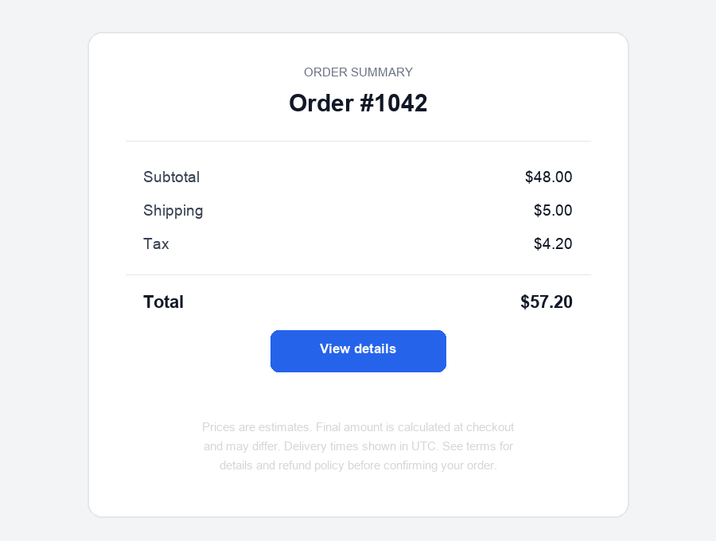

# eyes — what it sees, what it catches, what it can't

`eyes` gives text-only models structured sight: a local Mirage perception
model (~22 MB, CPU, $0/call) emits scene/object/OCR records, deterministic
detectors measure geometry and legibility, and `eyes ask` packages the
evidence for whatever reasoning model consumes it. Everything below is
real output from the eval catalog — planted defects, honest verdicts.

## The detectors that catch things

### Occlusion slicing text mid-glyph — `edge-bisect`


A dropdown menu painted *under* a card: "Duplicate" is sliced at the
card edge, "Archive"/"Delete" invisible. `eyes layout --describe`:

```
edge bisects (edge_bisect):
  'n..Eaakn'  horizontal line=239 cov=1.0 ink_dist=3px
```

The corrupted OCR string is named with its slice line. Control stays
clean; 9 out-of-domain eval images verified silent.

### Invoice arithmetic — `totals-consistency`


Subtotal bound wrong ($87.50) while items sum to $77.50; tax and total
derive consistently from the wrong subtotal — only summing catches it.
No model in the loop:

```
line_items_sum_mismatch: items=77.50 subtotal=87.50 delta=-10.00
(totals_block ok, tax_rate ok — internally consistent, wrong vs items)
```

### Aspect-ratio squash — `anisotropy-census`


16:9 dashboard force-fit to square. `eyes ask` pack reports
`anisotropic_squash` — blob cluster aspect 1.786, glyph w/h 0.318.
This is the case `eyes score` *cannot* attribute (defect outscores an
honest letterbox 66.0 vs 51.3 — relative similarity can't see internal
distortion); the detector owns that axis.

### Element dropout mid-sequence — `lifecycle-diff` in `eyes reel`


A "LIVE" badge present frames 1–2, silently gone 3–5 while everything
else animates:

```
lifecycle departures (dropout_detected):
  dropout   LIVE
  dropout   red circle
```

Cross-channel corroboration (OCR string + object departing at the same
boundary) is what makes it high-confidence; it refuses to false-positive
on frozen frames.

### Flicker/strobe — `strobe` in `eyes reel`


Uniform chaos: every pair reports ~1.2% changed — no outlier exists.
The strobe detector names the alternating element anyway:

```
strobes: 'LIVE' (ocr) present [1,3,5] absent [2,4,6]  confidence high
motion_coherence: uncorrelated_motion -0.5631
```

### Theme drift — `hue-census` in `eyes ask`


Same dashboard, content accents drifted blue→violet while chrome kept
brand blue. Zero reference needed — state B alone exposes two hue
families: `accent_hue_split` (violet 261° + blue 220°, ~49/49).

### Hostile type — `lexical-screen` in `eyes ask`


Calligraphic wordmark + letterspaced eyebrow: Mirage OCRs
`'delvered wechly'`, `'NE WSPRINGCOLLECTIoN'`. The lexical screen flags
both `non_lexical_text` — no model call, 263k-word lexicon.

### Low contrast — `legibility` in `eyes layout`



1.45:1 contrast fine print scored 97.9/100 against its own control before
the detector existed. Now:

```
'Prices are estimates...'  contrast 1.18  low_contrast + low_ocr_confidence
```

### Viewport clipping — `objects_at_edge` suspect flag


Card sliced by frame edges. Mirage's detection confidence collapses
(0.899→0.309) — now a named signal:

```
smartphone  top,right,bottom  score=0.309  suspect=True
```

## What the reasoning layer catches (evidence, not detectors)

`eyes ask  -q "..."` packs record + findings + detector outputs for
the consuming text model. Two cases live there:

- **text-truncation**: pack surfaces `"Quarterly Revenue Overview Rep"`
  verbatim — "Rep" is a sliced "Report". Text-level truncation is an
  inference problem on OCR output, not a pixel problem.
- **semantic-data**: the ask-pack question "do the items add up?" gets
  summed correctly by the reasoning layer — the deterministic detector
  now covers the additive-checkable subset.

## Honest limits — what it still can't see

- **Internal distortion in `score`**: relative similarity can't detect
  non-uniform resize (aspect-abuse proved it: defect outscores honest
  letterbox). Absolute detectors own that axis — by design, not bug.
- **Invisible boundaries**: `overflow:hidden` clips leave no pixel edge
  (text-truncation needed reasoning-layer judgment).
- **Uniform chaos characterization**: motion-coherence measures
  correlation, not *why* — unseeded randomness vs legitimate data churn
  reads identically (−0.16 on a healthy control). Reported as
  `uncorrelated_motion`, not "chaos".
- **Mirage noise floor**: ~300ms/frame, label instability on UI
  ("blue app icon" vs "orange light"), bbox jitter sets detector floors.
  Every detector documents its measured floor; sub-floor defects are
  genuinely dark.
- **Single-channel dropouts** degrade to `solo_departure`; elements
  Mirage never names are invisible to record-layer detectors.


## The real-backend arc — synthetic art was the easy half

Everything above was calibrated on PIL-drawn evals. The `evals/web-real/`
corpus tests the same detectors on uncontrolled real content: headless
Chrome captures of live sites (example.com, Wikipedia, MDN, BBC, GitHub,
HN), dark-mode emulation, print stylesheets, canvas raster, and scroll
sequences. What real content taught that synthetic art couldn't:

- **`luminance-theme`** — hue drift has a sibling: luminance drift.
  Dark theme + coherent light islands (web-theme-drift defect: 5.2%
  opposite-luminance in 78 rows) fires `luminance_theme_split`.
  BBC's dark masthead fires too — intentional vs drifted is a
  reasoning call, documented boundary.
- **`content-overflow`** — viewport clipping. Aggressive clip (480px
  fixed-width) fires via same-edge row clusters; at 768px defect and
  control converge to identical edge structure — a MEASURED hard
  boundary, not a tuning gap.
- **`nonuniform-scale`** — CSS scaleX(1.35) on canvas: glyph w/h
  median 0.90 vs 0.65 control. The Omni/Metal witness pattern:
  non-DOM raster needs pixel priors, not DOM semantics. Single-band
  evidence = review-flag tier by design.
- **Reel scroll-awareness** — `estimate_vshift` + `scroll_persistence`
  separate "new content scrolled in" from detector churn on real
  captures (verified ~300px steps, persistent_frac ~0.5).

## Detector catalog state

12 verified detectors + integrated layout/legibility/reel surfaces.
Every documented real-content FP class is either gated at spec level
(lexical prefix-noise, hue balance, pixel-edge chrome margin,
edge-bisect underline guard, anisotropy merged-band guard) or proven
unfixable-by-threshold with mechanism named (anisotropy tiny-glyph
geometry, content-overflow moderate clip). 19 eval entries; 30 tests.

## The loop that built this

`challenges/EYES_EVAL_CHALLENGE.md` generates defect cases →
`evals/` catalogs honest CAUGHT/PARTIAL/MISS verdicts →
`challenges/EYES_DETECTOR_CHALLENGE.md` builds instrumentation for the
dark regions → `detectors/` catalogs verified detectors → integration
into `eyes/` → regression. Two waves each; misses are first-class
results — the catalog's value is the honest map of blindness.
